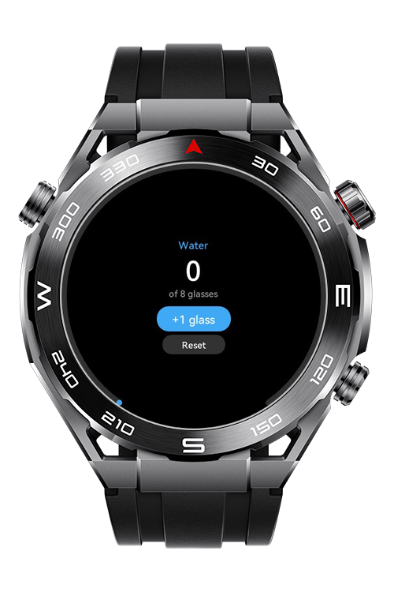
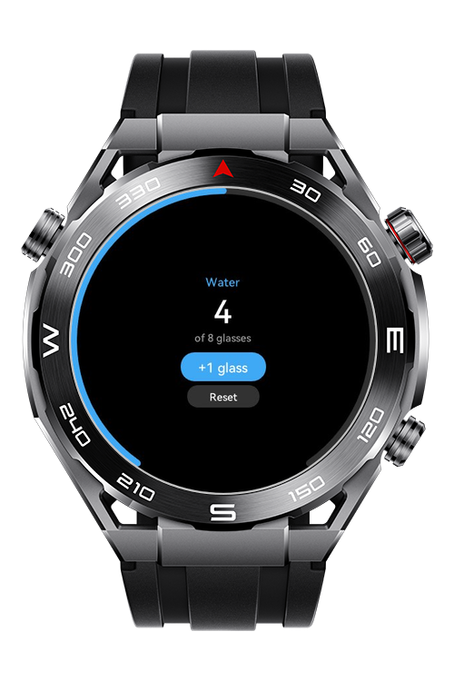
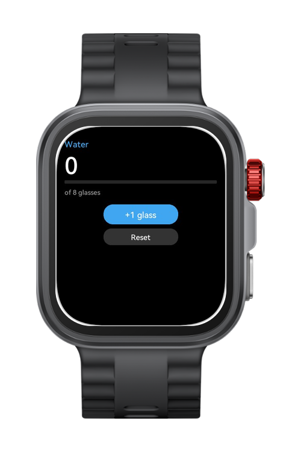
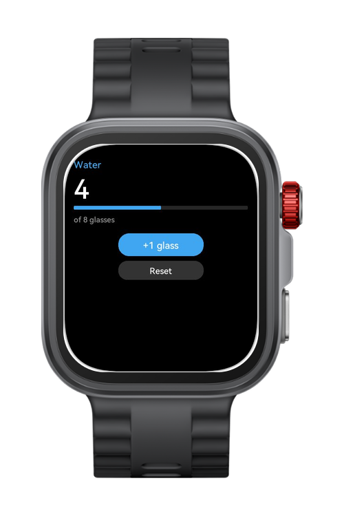

> **Note:** To access all shared projects, get information about environment setup, and view other guides, please visit [Explore-In-HMOS Index](https://github.com/Explore-In-HMOS/hmos-index).

# How To Implement Adaptive Layout

This codelab shows how to implement adaptive layouts for lite wearable devices that has round and rectangular screens. They both have different user experiences and layouts therefore they require to have some custom interfaces to provide a better experience to users. This codelab handles this case on CSS side using `@media` markers, which allows to select CSS layers conditionally according to device screen type.

# Preview

<div>




</div>

# Use Cases

* Adapt different UI components to different screen shapes
* Utilize radial and cornered designs for different screen shapes

# Tech Stack

* **Languages**: HML,CSS,JS
* **Frameworks**: HarmonyOS SDK 6.1.1(24)
* **Tools**: DevEco Studio Vers 6.1.1

# Directory Structure

```
entry/src/main/js/MainAbility
│    
├── pages/          
│   └── index/
│       ├── index.css
│       ├── index.hml
│       └── index.js
├── i18n/
│   ├── en-US.json
│   └── zh-CN.json
└──  app.js
```

# Constraints and Restrictions

## Supported Devices

- Huawei Sport (Lite) Watch GT 4/5/6
- Huawei Sport (Lite) GT4/5 Pro
- Huawei Sport (Lite) Fit 3/4
- Huawei Sport (Lite) D2
- Huawei Sport (Lite) Ultimate

# License

**How To Implement Adaptive Layout** is distributed under the terms of the MIT License. See the [LICENSE](LICENSE) for more information.
